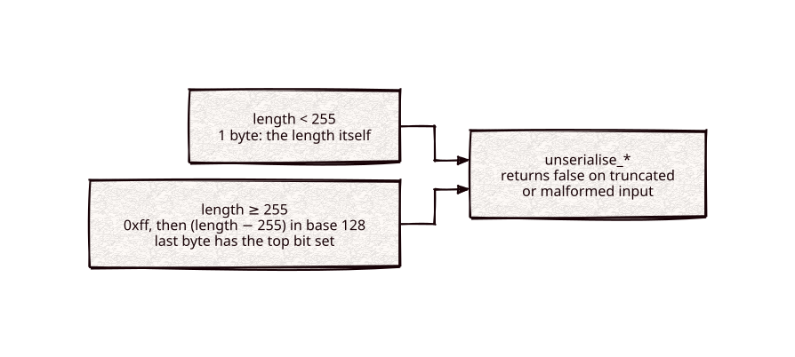

# varint

Part of [Kronuz C++ Libraries](https://github.com/Kronuz/cpp-libraries), a collection of small, reusable C++ libraries.

[](https://github.com/Kronuz/varint/actions/workflows/ci.yml)
[](LICENSE)


A compact, exception-free length and integer codec for C++17: one byte for any
length below 255, a base-128 tail for the rest, plus length-prefixed strings,
bools, chars, and standard LEB128. For wire protocols and on-disk records that
decode untrusted input.



## ✨ Highlights

- **One byte for the common case.** Short strings and small counts cost a single
  length byte.
- **No exceptions.** Every decoder returns `false` on truncated or malformed
  input, so parsing a socket buffer is a plain `if`.
- **Hardened against hostile input**, with overflow checks on every byte and a
  libFuzzer target over every decoder.
- **No allocation on the hot path.** `serialise_length(char* out, v)` writes into
  your buffer.
- **LEB128 too**, for large integers such as sparse id gaps.
- **Wire-compatible** with Xapiand's original `length.h` encoding.

## 📦 Installation

Requires a C++17 compiler; CMake 3.14 or newer for the CMake route. CI builds it
on Linux (x86_64, arm64), macOS (arm64, x86_64), and FreeBSD, plus ASan, UBSan,
and TSan builds.

```cmake
include(FetchContent)
FetchContent_Declare(varint
  GIT_REPOSITORY https://github.com/Kronuz/varint.git
  GIT_TAG        main)
FetchContent_MakeAvailable(varint)

target_link_libraries(my_app PRIVATE varint::varint)
```

Or copy `varint.hh` onto your include path.

## 🚀 Quick start

```cpp
#include "varint.hh"

#include <string>

int main() {
	std::string wire = varint::serialise_string("hello") + varint::serialise_length(1'000'000);

	const char* p = wire.data();
	const char* end = p + wire.size();
	std::string_view name;
	unsigned long long count = 0;
	if (!varint::unserialise_string(&p, end, name) || !varint::unserialise_length(&p, end, count)) {
		return 1;   // truncated or malformed
	}
	// name == "hello", count == 1000000, p == end
}
```

[`examples/demo.cc`](examples/demo.cc) encodes and decodes a short message.

## 🎯 When to use it

- ✅ Length prefixes and counts in a binary format, decoded from untrusted bytes.
- ❌ Schema-driven messages: use a serialization format (MessagePack, protobuf)
  when you need fields, types, and evolution.

## 📚 Documentation

- [docs/API.md](docs/API.md): every encoder and decoder, including `leb128`.
- [ARCHITECTURE.md](ARCHITECTURE.md): the wire format and the overlong-input
  guards.
- [AGENTS.md](AGENTS.md): repository map, invariants, and traps.

## 🛠️ Building and testing

```sh
cmake -B build && cmake --build build && ctest --test-dir build
./build/varint_demo
```

The tests pin exact bytes against reference vectors, so the wire format cannot
drift silently.

## 🤝 Contributing

Issues and pull requests are welcome. The wire format is fixed; read
[AGENTS.md](AGENTS.md) first. CI must pass on every platform.

## 📄 License

MIT, Copyright (c) 2026 Germán Méndez Bravo. See [LICENSE](LICENSE). An
independent implementation, wire-compatible with Xapiand's `length.h`.
